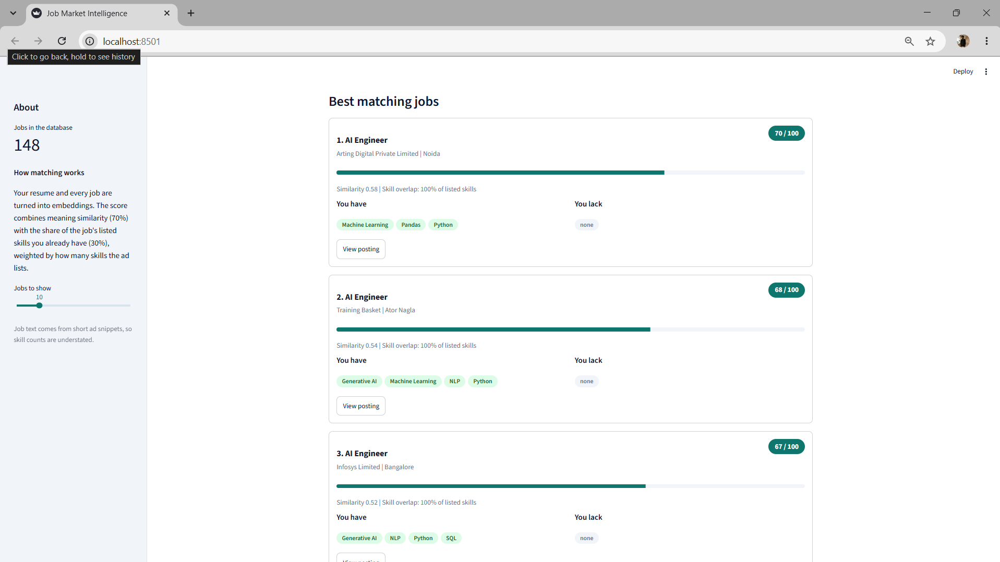
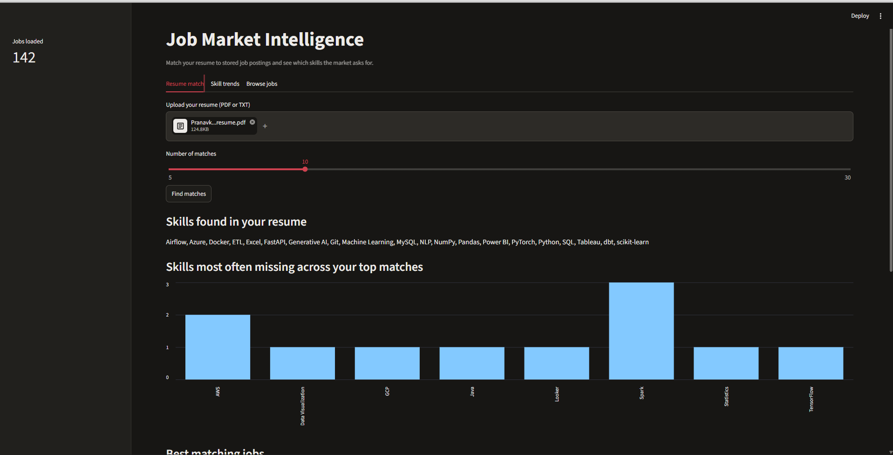
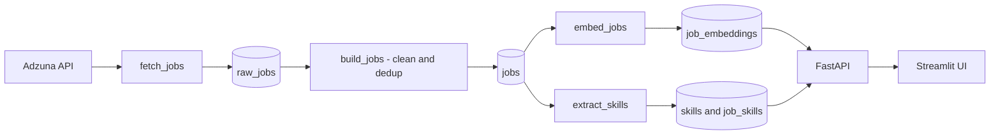

# Job Market Intelligence Platform


A data and AI pipeline that collects job postings, extracts the skills employers ask for,
and matches a resume to the best-fitting jobs, showing which skills you already have and which you lack.




## What it does
1. **Ingests** job postings from the Adzuna API into PostgreSQL (raw data kept untouched).
2. **Cleans and deduplicates** them into a tidy `jobs` table.
3. **Extracts skills** with a dictionary-based extractor, evaluated against hand-labelled jobs.
4. **Embeds** every job with a sentence-transformer model.
5. **Matches** an uploaded resume to jobs using embedding similarity plus skill overlap.
6. **Serves** everything through a FastAPI service and a Streamlit dashboard.

## Architecture



## Tech stack
Python, PostgreSQL, sentence-transformers (all-MiniLM-L6-v2), NumPy, FastAPI, Streamlit,
pytest, GitHub Actions.

## Results
| Measure | Value |
|---|---|
| Jobs in database | 142 |
| Skill extraction, batch 1 (23 jobs) | precision 93.75%, recall 93.75% (labels corrected after seeing output, so optimistic; 500-character snippets) |
| Skill extraction, batch 2 (30 jobs, 500-character snippets, extractor-assisted review) | precision 81.8%, recall 95.7% |
| Automated tests | 22 passing |

## Quick start (local)
```bash
python -m venv .venv
source .venv/Scripts/activate        # Git Bash on Windows
pip install -r requirements.txt
cp .env.example .env                 # then add your Adzuna keys and database URL
psql -U postgres -c "CREATE DATABASE jobs;"
for f in sql/*.sql; do psql -U postgres -d jobs -f "$f"; done
python -m src.ingestion.fetch_jobs
python -m src.processing.build_jobs
python -m src.processing.extract_skills
python -m src.matching.embed_jobs
uvicorn src.api.main:app             # API on http://127.0.0.1:8000/docs
streamlit run ui/streamlit_app.py    # UI on http://localhost:8501
```

## API
| Endpoint | Purpose |
|---|---|
| GET /health | status and number of jobs loaded |
| GET /jobs?q=&limit= | search jobs by title |
| GET /trends/skills?limit= | most requested skills |
| POST /match?top= | upload a resume (PDF or TXT), get ranked jobs and skill gaps |

## How matching works
`score = 0.7 x cosine similarity + 0.3 x skill overlap x confidence`, where confidence is
`min(skills listed in the ad, 3) / 3`. The confidence term stops ads that list one skill from
getting a perfect overlap score.

## Design decisions and limitations
- Adzuna returns a ~470 character snippet, not the full description, so skill recall is limited.
- Dedup uses company + normalised title + location, so the same ad posted with different
  locations is not merged.
- The skill dictionary has about 35 skills and cannot tell a requirement from a company blurb.
- Embeddings are stored as plain arrays and compared in NumPy, which is fine for thousands of
  jobs. pgvector would be the next step at larger scale.

## Data and licensing
Job data comes from the Adzuna API under its terms and is not stored in this repository.
Add your own API keys in `.env`.

## Project structure
```
src/ingestion   API fetching and parsing
src/processing  cleaning, dedup, skill extraction
src/matching    embeddings, scoring, resume matching
src/api         FastAPI service
src/evaluation  hand-labelling and scoring tools
ui              Streamlit dashboard
sql             table definitions
tests           pytest suite
```

## Roadmap
- Orchestrate the pipeline with Airflow
- Fetch full job descriptions from a second source
- Hybrid search (keywords plus embeddings) and a reranker
- Authentication and deployment

## License
MIT
